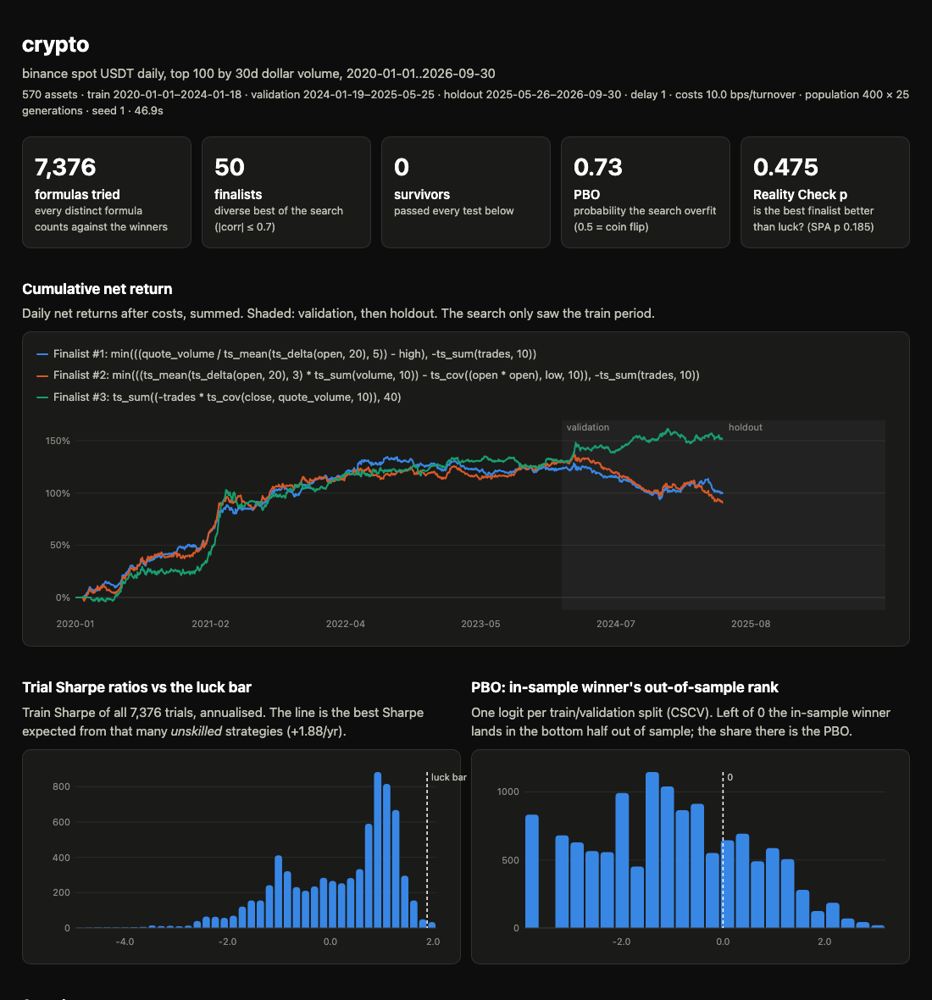

# falsealpha

[](https://github.com/owen-alderson/falsealpha/actions/workflows/ci.yml)
[](LICENSE)

**A C++ engine that searches thousands of formulaic trading signals, then tells you which of its own discoveries are fake.**


Search hard enough and you will always find a backtest that looks good. falsealpha does the search fast in C++20, records every formula it tried, and keeps a result only if it beats the luck it took to find it.

```
$ falsealpha data noise --out noise.npz          # 2,500 days x 60 assets of pure noise
$ falsealpha mine noise.npz runs/noise
6002 formulas tried -> 50 finalists -> 0 survivors
  luck bar (train): best of 6002 unskilled strategies ~ Sharpe +1.84 /yr
  Reality Check p 0.942 (gate)   SPA p 0.800
  PBO 0.95  (share of splits where the in-sample best finalist lands in the bottom half)

$ falsealpha data planted --out planted.npz      # same, plus one hidden alpha
$ falsealpha mine planted.npz runs/planted
6397 formulas tried -> 50 finalists -> 3 survivors
  luck bar (train): best of 6397 unskilled strategies ~ Sharpe +1.85 /yr
  Reality Check p 0.000 (gate)   SPA p 0.000
  PBO 0.00  (share of splits where the in-sample best finalist lands in the bottom half)
  [PASS] train +5.87 (DSR 1.00)  val +4.94 (DSR 1.00)  (decay_linear(ts_sum(volume, 3), 5) * ts_sum(volume, 5))
$ falsealpha unseal runs/planted
combined: holdout Sharpe +4.08 /yr, P(true Sharpe > 0) 1.00, 498 days
```

Across 30 independent noise panels (1,500 days × 60 assets, population 200 × 6 generations; [`scripts/noise_calibration.py`](scripts/noise_calibration.py)), the firewall let through **0** formulas. The Reality Check gate never opened (0 of 30); the Deflated Sharpe alone would also have caught everything. Mean PBO was 0.49, a coin flip, which is what overfitting to noise looks like.

## On real data: six years of crypto

The default search on every Binance USDT pair that was ever in the daily top 100 by dollar volume: 2,465 days × 570 assets, delisted coins included, 10 bps costs, trading one day after the signal.

```
$ falsealpha data binance --out data/binance-top100.npz
$ falsealpha mine data/binance-top100.npz runs/crypto        # 45 s on an M3 Pro
7376 formulas tried -> 50 finalists -> 0 survivors
  luck bar (train): best of 7376 unskilled strategies ~ Sharpe +1.88 /yr
  Reality Check p 0.475 (gate)   SPA p 0.185
  PBO 0.73  (share of splits where the in-sample best finalist lands in the bottom half)
  [fail] train +2.06 (DSR 0.64)  val -1.08 (DSR 0.00)  min(((quote_volume / ts_mean(ts_delta(open, 20), 5)) - high), -ts_sum(trades, 10))
  [fail] train +2.01 (DSR 0.60)  val -1.79 (DSR 0.00)  min(((ts_mean(ts_delta(open, 20), 3) * ts_sum(volume, 10)) - ts_cov((open * open), low, 10)), -ts_sum(trades, 10))
  [fail] train +1.86 (DSR 0.48)  val +1.02 (DSR 0.14)  ts_sum((-trades * ts_cov(close, quote_volume, 10)), 40)
```

The best formula the search found earns a Sharpe of +2.06 a year over four years of training data, after costs. Shown alone, that is a backtest people trade. The firewall rejects it on the training data already: 7,376 tries at nothing would be expected to produce about +1.88 by luck, so its Deflated Sharpe is only 0.64. On the next 16 months, which the search never saw, it loses money (−1.08 a year), and so does the runner-up (−1.79). The few finalists that stay positive out of sample (+1.02 at best) are well within what luck explains over 493 days (Reality Check p = 0.48), and PBO is 0.73: picking the in-sample best finalist usually picks a below-median one.

So the honest result of this run is **no tradable alpha**, and the holdout (May 2025 to September 2026) stays sealed for a better search. That is the tool working: it is built to say "no" when the evidence is not there.




## How it works

```
 panel ──► train ──────────────► validation ──────────► holdout (sealed)
           GP search, every       finalists scored       opens once, after
           formula logged         on unseen days         you stop searching
              │                        │                       │
              ▼                        ▼                       ▼
        Deflated Sharpe vs     Deflated Sharpe vs        combined survivors:
        ALL trials             the finalists; Reality    Sharpe, P(Sharpe > 0);
                               Check gate; PBO           every look logged
```

1. **Search.** Genetic programming over an Alpha101-style formula language: ramped half-and-half initialisation, subtree crossover, point / subtree / hoist mutation, tournament selection, a parsimony penalty, and a novelty penalty against a hall of fame so it keeps finding *different* signals rather than near-copies (|corr| ≤ 0.7 between finalists). Fitness is the net long-short Sharpe on the train period only.
2. **Ledger.** Every distinct formula the search scores is written to `ledger.csv.gz` (formulas are canonicalised, so `a + b` and `b + a` count once). This is the *N* in the multiple-testing correction, not just the winners.
3. **Firewall.** A finalist survives only if it passes all of:
   - **Train Deflated Sharpe ≥ 0.95** ([Bailey & López de Prado 2014](https://papers.ssrn.com/abstract=2460551)): the train Sharpe must beat the expected maximum of *N* unskilled strategies, where *N* is the whole ledger.
   - **Validation Sharpe > 0 with Deflated Sharpe ≥ 0.95**, deflated for the number of finalists scored on the unseen validation days.
   - **White's Reality Check, p < 0.05** ([White 2000](https://doi.org/10.1111/1468-0262.00152)), a global gate on validation returns: is the best finalist better than flat once you allow for having looked at all of them? Stationary bootstrap (mean block 10, 1,000 draws). Hansen's SPA test ([Hansen 2005](https://doi.org/10.1198/073500105000000063)), the studentised version with consistent recentring, is reported alongside but is not the gate: at this sample size its measured size is 8–9% at a nominal 5%, while the Reality Check holds 4.5–6% ([`scripts/snoop_size.py`](scripts/snoop_size.py), 1,000 null simulations per setting).
   - **PBO** ([Bailey, Borwein, López de Prado & Zhu 2017](https://papers.ssrn.com/abstract=2326253)) is reported, computed over the finalists' train + validation returns: combinatorially symmetric cross-validation over 16 blocks (12,870 splits), the share where the in-sample best finalist lands in the bottom half out of sample.
4. **Holdout.** The search and validation never receive the holdout days: the panel is physically truncated before they run. `falsealpha unseal` scores the survivors and their equal-risk combination on the holdout once; a second look needs `--force`, and the report shows every look.

**One deliberate deviation from the DSR paper.** The paper sets the luck bar from the variance of Sharpe ratios *across* trials. In a search that finds something real, dozens of variants of that signal inflate that variance and the test ends up punishing the discovery (on the planted data it rejects a true signal with a Sharpe of 9). falsealpha uses the null variance, 1/(T−1): the expected best of *N* strategies with no skill. Counting every distinct formula as a trial overstates the number of independent trials, so the bar is conservative. The paper's version is still computed and stored (`sr0_train_paper`).

## Quick start

```bash
pip install falsealpha

falsealpha data planted --out planted.npz   # random data with one hidden alpha
falsealpha data noise   --out noise.npz     # random data, no alpha at all
falsealpha mine planted.npz runs/planted    # search + firewall + runs/planted/report.html
falsealpha unseal runs/planted              # look at the holdout, once

falsealpha data binance --out binance.npz   # every USDT pair, delisted included (~10 min download the first time)
falsealpha info binance.npz
falsealpha eval binance.npz "-rank(ts_delta(close, 5))"
falsealpha mine binance.npz runs/crypto
```

Each run writes `config.json`, `ledger.csv.gz`, `finalists.json`, `nets.npy`, `holdout.json` and a self-contained `report.html` (no network, light and dark mode).

### Python

```python
import falsealpha as fa
from falsealpha import run

panel = fa.Panel.load("binance.npz")
signal = fa.evaluate("rank(ts_corr(close, volume, 10))", panel.core())        # days x assets
bt = fa.backtest(signal, "returns", panel.core(), delay=1, cost_bps=10)       # daily IC, gross, cost, net
fa.summarize(bt, 0, 1000)                                                     # Sharpe, IC, IC IR, turnover

verdict = run.mine("binance.npz", "runs/x", run.MineConfig(population=400, generations=25))
```

The statistics are exposed on their own: `fa.expected_max_sharpe`, `fa.probabilistic_sharpe`, `fa.pbo`, `fa.snoop_tests`.

## Formula language

Fields are whatever the panel holds; Binance panels have `open high low close volume quote_volume vwap returns trades`. Infix `+ - * /` and unary minus work, as do numeric constants.

| kind | operators |
|---|---|
| elementwise | `neg abs log sign add sub mul div max min` |
| cross-sectional (universe members, one day) | `rank zscore demean scale` |
| time-series (trailing *d* days, today included) | `ts_delay ts_delta ts_sum ts_mean ts_std ts_zscore ts_min ts_max ts_argmin ts_argmax ts_rank decay_linear ts_corr ts_cov` |

NaN rules: a time-series window must be full of real data; cross-sectional ops only see universe members with a value; a variance below 1e-20 of the mean square counts as zero.

**Backtest convention.** Weights are the cross-sectional rank of the signal, demeaned and scaled to gross 1 (dollar-neutral). A signal built from data up to close *t* trades at close *t+delay* (default 1) and earns the next day's return. Costs are charged per unit of turnover. A member with no next-day return (delisted, gap) earns 0, i.e. it is sold at its last price.

## The engine

- **Time-major panels.** A *T × N* panel stores one contiguous row of assets per day, so time-series ops sweep rows with per-asset state (vectorised across assets) and cross-sectional ops work on one contiguous row.
- **O(1) rolling sums** with a periodic rebuild so floating-point drift can't build up; **van Herk / Gil-Werman** sliding min/max; `decay_linear` by recurrence.
- **Exact second moments.** `ts_std`, `ts_zscore`, `ts_corr` and `ts_cov` are computed two-pass over each window. Running-moment updates (sums of squares, even rolling Welford) lose relative precision when a quiet window follows a volatile history at a high price level; the test suite has the random walk that proves it.
- **Common subexpressions** within a formula are computed once; only repeated subtrees are cached, so memory stays at about one panel per tree level.
- **Parallel over formulas**, deterministic for a given seed regardless of thread count (on one platform: C++ standard libraries draw random numbers differently); the GIL is released.

**Verified, not assumed:**
- every operator matches an independent, loop-per-window numpy reference to 1e-9 (relative), including NaN holes, universe masks, constant columns and 3,000-day random walks at a price level of 5,000,000;
- a property test perturbs every input after day *k* and checks no operator's output on or before day *k* moves (no look-ahead, by construction);
- the Deflated Sharpe reproduces the worked example in Bailey & López de Prado (2014) (SR₀ = 0.1132, DSR = 0.9004);
- the Reality Check rejects at about its nominal 5% on noise (SPA over-rejects at this sample size, measured and documented above) and both have power on a real edge; PBO averages about 0.5 on noise and about 0 with a dominant strategy;
- the search recovers a planted alpha, the firewall passes it and rejects pure noise;
- C++ tests run under AddressSanitizer and UBSan in CI.

## Speed

Apple M3 Pro (11 cores), 2,000 days × 500 assets, best of 3:

| | time | vs pandas |
|---|---:|---:|
| 12 Alpha101-style formulas, falsealpha, 1 thread | 501 ms | 6.6× faster |
| same, 11 threads | 131 ms | 25× faster |
| same, pandas | 3,307 ms | |

| operator (1 thread) | falsealpha | pandas | |
|---|---:|---:|---:|
| `rank(close)` | 29.7 ms | 37.0 ms | 1.2× |
| `ts_mean(close, 20)` | 1.9 ms | 11.5 ms | 6× |
| `ts_std(close, 20)` | 8.8 ms | 19.1 ms | 2× |
| `ts_corr(close, volume, 20)` | 20.2 ms | 77.6 ms | 4× |
| `ts_max(close, 20)` | 3.3 ms | 21.0 ms | 6× |
| `ts_argmax(close, 20)` | 28.0 ms | 774 ms | 28× |
| `ts_rank(close, 20)` | 10.3 ms | 1,076 ms | 104× |
| `decay_linear(close, 20)` | 3.6 ms | 520 ms | 145× |

The honest reading: on operators pandas implements in C (`rank`, rolling mean/std/corr) the gain is 1–6×, and `ts_std` / `ts_corr` deliberately pay for an exact two-pass computation. The large gains are on window operators pandas can only do through Python-level `rolling().apply()`. In a search, the parallelism is over formulas, so throughput scales with cores: the default noise run above scored 6,002 formulas over 2,500 days × 60 assets in about 5 seconds.

`falsealpha bench` reproduces this. The pandas side evaluates the *identical* formula text (canonical formulas are valid Python expressions) with the usual pandas idioms: `rolling()`, `rank(axis=1, pct=True)`, `rolling().apply()` where pandas has no built-in. Where the definitions coincide the two agree to 1e-8 (tested). Most of falsealpha's single-thread time is `rank`, a sort per day, which pandas also does in compiled code; the big gaps come from window operators pandas can only do through Python-level `apply`.

## Data

**Crypto (built in).** Binance's public dump ([data.binance.vision](https://data.binance.vision)) keeps every spot pair's daily candles, including pairs that were delisted, which is what makes a survivorship-free universe possible. The loader:
- drops stablecoins, fiat pairs and leveraged tokens;
- splits a ticker into separate assets when it goes more than 7 days without candles (LUNAUSDT resumes 18 days after the May 2022 collapse as a different coin);
- handles the switch from millisecond to microsecond timestamps in 2025;
- builds the universe each day from data up to that day: the top *N* by trailing 30-day dollar volume, with at least 60 days of history;
- starts the panel in 2020 by default: before that Binance had fewer than 40 liquid USDT pairs on a typical day, too few for cross-sectional ranks (earlier data still counts as history).

**US equities (planned).** Free daily data with delisted names is scarce. The plan is point-in-time S&P 500 membership ([fja05680/sp500](https://github.com/fja05680/sp500)) plus Tiingo's free tier, which carries delisted tickers, with results reported three ways (survivors only, point-in-time, and a delisting-loss stress) so the remaining bias is visible. yfinance can't be used: it has no delisted tickers and returns a different company for reused ones.

## Limitations

- Daily bars only; costs are a flat charge per unit of turnover, with no market impact or borrow costs.
- A delisted asset is assumed sold at its last close. Real exits can be worse.
- The holdout seal is an honour system with an audit trail (the look log and a fingerprint of the panel file), not cryptography.
- Counting distinct formulas as trials is conservative; clustering trials into independent groups would give a sharper luck bar.
- `falsealpha eval` shows validation results for any formula you type, and those looks are not counted. Hand-testing ideas on validation is a search the firewall cannot see; keep it to train, or count it yourself.

## Development

```bash
python -m venv .venv && .venv/bin/pip install scikit-build-core pybind11 numpy pandas pytest certifi
.venv/bin/pip install --no-build-isolation -e ".[dev]"
.venv/bin/pytest                                                   # Python suite
cmake -S . -B build -DFALSEALPHA_BUILD_TESTS=ON && cmake --build build -j && ./build/core_tests
```

## References

- D. H. Bailey, M. López de Prado (2014). The Deflated Sharpe Ratio: Correcting for Selection Bias, Backtest Overfitting and Non-Normality. *Journal of Portfolio Management* 40(5).
- D. H. Bailey, J. Borwein, M. López de Prado, Q. J. Zhu (2017). The Probability of Backtest Overfitting. *Journal of Computational Finance* 20(4).
- P. R. Hansen (2005). A Test for Superior Predictive Ability. *Journal of Business & Economic Statistics* 23(4).
- H. White (2000). A Reality Check for Data Snooping. *Econometrica* 68(5).
- D. N. Politis, J. P. Romano (1994). The Stationary Bootstrap. *JASA* 89(428).
- C. R. Harvey, Y. Liu, H. Zhu (2016). …and the Cross-Section of Expected Returns. *Review of Financial Studies* 29(1).
- Z. Kakushadze (2016). 101 Formulaic Alphas. *Wilmott* 2016(84). [arXiv:1601.00991](https://arxiv.org/abs/1601.00991)

MIT licence.
